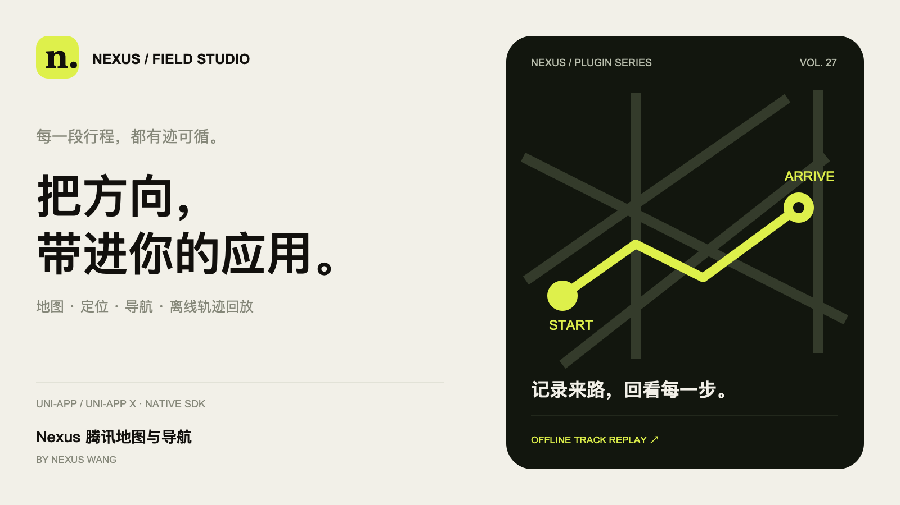
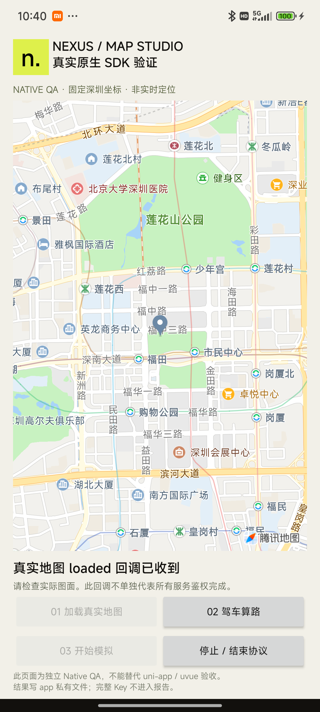
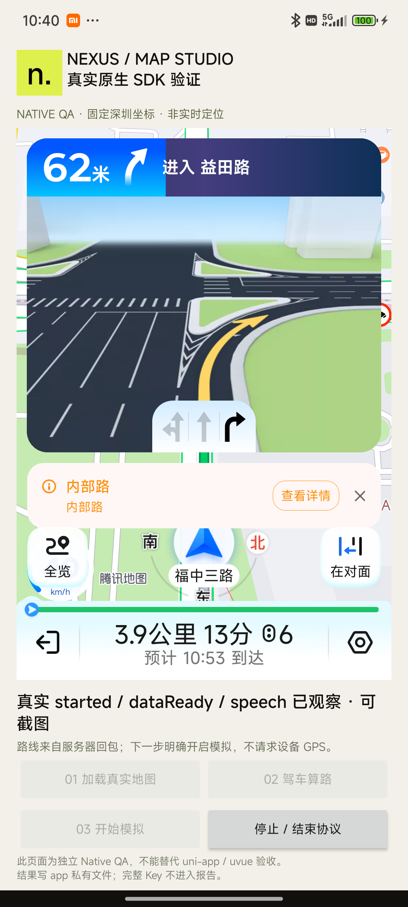

# Nexus 腾讯地图与导航

**Nexus Wang · uni-app / uni-app x · 1.0.1**

把方向，带进你的应用。

腾讯原生地图、定位、搜索和驾车 / 货车 / 步行 / 骑行导航，新增本地离线轨迹记录与回放。

[购买与免费试用](https://ext.dcloud.net.cn/plugin?id=30642) · [完整 API 与接入文档](docs/api-and-setup.md) · [Android 配置模板](examples/android/README.md) · [全部 Nexus 插件](https://awak3n1ngone.github.io/nexus-uniapp-plugins/)

| 授权版本 | 价格 |
| --- | --- |
| 普通授权版 | ¥59.90 |
| 源码授权版 | ¥1999.00 |

价格及授权条件以插件市场页面为准。腾讯 SDK 商业授权、导航服务与配额由使用方自行配置，不包含在插件售价中。

## 真实地图与模拟导航

以下图片来自 Android 14 手机上的独立 Native 测试宿主，使用固定深圳 GCJ02 示例坐标。不是设备实时定位，也不是 uvue 页面运行截图；封面是品牌插画。

| 真实地图与标记 | SDK 模拟导航 |
| --- | --- |
|  |  |

## 功能

- 内嵌地图：中心与缩放、标记、折线、覆盖物清理、状态查询及销毁。
- 前台定位：显式授权后的单次定位与持续定位，页面隐藏或进入后台时清理自有任务。
- 在线搜索：关键词 / 周边 POI、地址解析及逆地址解析。
- 路线与导航：驾车、货车、步行、骑行路线，真实路线选择、模拟导航与 GPS 导航接口。
- 离线轨迹：本地记录、暂停 / 继续、分段回放、里程与时长、JSON 导出及删除；不自动采集或上传位置。
- 坐标工具：距离与简单多边形面积测量。

接口范围与实测范围分别记录。货车高级自定义路线等腾讯额外付费能力不属于本版承诺范围。

## 接入

1. 在[插件市场](https://ext.dcloud.net.cn/plugin?id=30642)试用或购买后导入 `nexus-tencent-map`。
2. 在腾讯位置服务控制台配置自己的平台 Key 与包名。Android 宿主同时配置 `TencentMapSDK` 元数据和初始化 Key，使用[配置模板](examples/android/README.md)。
3. 取得最终用户的隐私同意后初始化，再挂载 `<nexus-tencent-map>`；需要定位时另行申请权限。
4. 重新制作自定义调试基座 / 原生安装包。新增 SDK、原生依赖或 Key 元数据不能仅靠页面热更新生效。

完整 API、示例参数、货车字段与事件语义见[接入文档](docs/api-and-setup.md)。真实 Key 不提交 GitHub，SecretKey 不放入客户端。

## 平台范围

| 项目 | 范围 |
| --- | --- |
| HBuilderX | 建议 5.34+ |
| Android | minSdk 23，原生 ARM 库；uni-app nvue、uni-app x uvue VDOM |
| iOS | iOS 13.4+ / arm64；已完成类型检查与链接，尚未完成 iPhone 运行验收 |
| 不支持的视图形态 | 普通 App vue / Web、小程序、鸿蒙、蒸汽模式 |

市场沿用 UTS API 分类，同时提供兼容模式原生视图。1.0.1 已在 HBuilderX 5.34 以该分类编译 API、组件注册和 Android uvue 消费者；编译结果不等于 uvue 真机在线流程验收。

## 已验证与未验证

2026-11-08 的 Android 原生实测已确认真实地图、服务器驾车路线、模拟导航、匹配导航会话的数据就绪、TTS 开始 / 结束与停止回调。8 次 Native 接口回调均一次、主线程、`code=0`，无协议超时或生命周期中断。

本轮未验收 UTS/uvue 真机在线流程、iOS 真机、GPS 导航、在线 POI / 地理编码、货车 / 步行 / 骑行及多机型稳定性。TTS 回调不代表物理扬声器可听性已独立验证。详细记录见[验证范围](docs/verification.md)。

## 1.0.1 更新

- 补齐导航布局所需的 RecyclerView 1.3.2，修复导航视图创建失败。
- 修正数据就绪事件中的导航会话 ID 语义，保留明确弃用的兼容别名。
- 补齐宿主 Android Key 配置说明与真实地图 / 模拟导航截图。

[完整更新记录](CHANGELOG.md)

## 仓库内容

本仓库公开插件说明、接入配置模板与真实截图。收费的 Kotlin / Swift / UTS 实现、第三方 SDK 二进制、测试 APK、签名文件及真实 Key 均未包含。插件通过官方市场获取。

作者：**Nexus Wang**。
